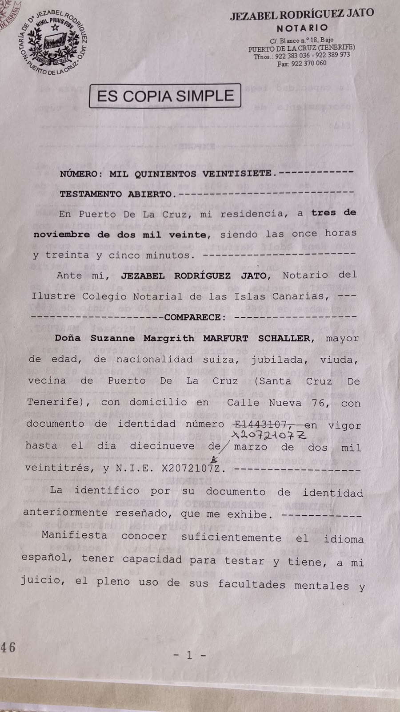

# WhatsApp Chat Export - 20261009_191532

**24.10.24 16:10:34 - Marfurt**
‎Les messages et les appels sont chiffrés de bout en bout. Seules les personnes prenant part à cette discussion peuvent les lire, les écouter ou les partager.
---
**24.10.24 16:10:34 - Marfurt**
‎Vous avez créé le groupe "Marfurt"
---
**24.10.24 16:12:19 - Georges Marfurt**
Voilà le nouveau groupe. Je peux donner un autre nom.
---
**24.10.24 16:12:47 - Georges Marfurt**
Le notaire vient de passer. Tout est ok
---
**24.10.24 17:48:18 - David Bernat**
‎
[00000005-AUDIO-2024-10-24-17-48-18.opus](00000005-AUDIO-2024-10-24-17-48-18.opus)

**Transcription:**
Bon, je me suis m'affaire très bien. Non, vous pouvez laisser ces longs et vous voulez. On a aussi arrangé déjà les cennumeraux dans la police. On a eu de la sorte de la drogue du rendez-vous libre dans la laisser. Et on a assez assez à des jagés. Vous s'envoirons des mains. Les documents avec cette nouvelle neuropole. C'est la même prochaine. On ne vous remetre pas en contact. Vous pouvez comment est-ce qu'on fait après. Une chose nous devons faire la registration de la nouvelle employée pour votre mère. Nous nous disons, on nous a dépendu de l'héros, les lérons, des mains dans l'hôpital. Si l'eau plaît, nous sommes formés de tout ce qui est passé et on verra pour aller plus loin.
---
**25.10.24 11:39:58 - Georges Marfurt**
Merci pour l’avancement des travaux. À propos des aides pour maman comme Julia, le physiothérapeute , et aussi matérielle comme la chaise, etc, on se demandait si les coûts étaient pris en charge par son assurance privée (Sanitas). Je vais essayer de trouver son contrat et  peut-être je reviens vers vous pour m’aider à vérifier ses droits.
Je vous tiens au courant de l’état de santé de maman.
Cordialement
---
**25.10.24 13:51:49 - David Bernat**
D'accord. Merci.
---
**06.01.25 14:25:29 - Georges Marfurt**
Bonjour Monsieur Bernat,
J’espère que vous allez bien et je vous adresse mes meilleurs vœux pour une nouvelle année pleine de succès et de sérénité.
Il y a longtemps que je souhaitais vous donner des nouvelles de notre maman, bien que la situation n’ait pas beaucoup évolué. Elle reste majoritairement alitée et dépendante des soins à domicile.
Par ailleurs, pourriez-vous m’indiquer quand nous pourrons recevoir les documents signés lors de notre séjour à Puerto ?
Dans l’attente de votre retour, je vous adresse mes meilleures salutations.
Cordialement,
Georges Marfurt
---
**09.01.25 14:45:27 - David Bernat**
‎
[00000009-AUDIO-2025-01-09-14-45-27.opus](00000009-AUDIO-2025-01-09-14-45-27.opus)

**Transcription:**
Bonjour, Monsieur Martou. Merci. J'ai vouloé tous les meilleurs bières pour les nouvel années. Oui, les retures de la nature qui l'ont a, et déjà registrer, il n'y a pas encore fini parce que le manque encore, c'est un pro qui ont dû appeler la mérée et tout ça. Mais je ne comprends pas, vous voulez qu'on vous s'envoie à celui, c'est le comment notarriel, parce que nos moments l'essicile, parce que nous dois faire quelque chose, on les fait ici, à l'espan, non? On les ici, dans les bours, et dans les gens, on vient, on se trouve venez une autre fois, normalement, ils le prendent, c'est de comment, parce que ce sont de comment pour agir ici à l'espan. Et si vous voulez, on peut vous envoyer avec la récitation de la récitation de la groupité et le document, escanny, et donc, et puis, et puis, répliquer, je crois que c'est ça ce que vous référez.
---
**09.01.25 16:42:29 - Georges Marfurt**
Bonjour monsieur Bernat,
avoir une copie en pdf nous suffira amplement.
Merci d’avance
Georges Marfurt
---
**18.02.25 08:19:31 - Sabine Spielmann**
Bonjour M. Bernat, je vous ai envoyé un mail début février, mais comme je n’ai pas de nouvelles, je me demandais si votre adresse email est correcte ! Pouvez-vous me dire si vous avez bien reçu le mail ? Merci beaucoup. Sabine
---
**20.02.25 20:09:31 - David Bernat**
‎
[00000012-AUDIO-2025-02-20-20-09-31.opus](00000012-AUDIO-2025-02-20-20-09-31.opus)

**Transcription:**
Bonjour, Madame Spillman. C'est moi que je n'ai vousérépont deux. Juste que maintenant, mais ce que nous avons, beaucoup de travail, les dernières d'us et les amènes. Et je ne suis pas très avec Juan et le m'arraconté, de zoumoins, les choses qui se sont passées. Je vais essayer des bouss appeler la prochaine sémant. Les mardios, mes credits, je crois que je pourrais les faire. Mais c'est qu'elle m'a raconté la manière, c'est à la défaire d'un léger, d'un capacité des projets, aux régiers des projets qui l'increpatent, de laisser des faire les choses par soi-même. Et pour soi, sur d'être une processie judiciaire, ça l'est faire. J'ai pensé, c'est exactement ce que vous voulez. Parce qu'une tentez cas, vous avez venu réussir, pour tout oranger. Comme je vous ai dit, c'est de m'approcher, de mardi, et de m'accréder. Vous savez, en plus, il est temps. Il y a vous appellent. Vous vous m'avez dit, ça a été mieux, qu'est-ce que vous embolez faire.
---
**21.02.25 18:14:44 - Sabine Spielmann**
Bonsoir M. Bernat, alors ce serait bien si vous pouviez appeler mardi, dites-moi à quelle heure, ainsi mon frère sera aussi là ! Merci et bon week-end! Sabine
---
**24.02.25 21:12:44 - David Bernat**
‎
[00000014-AUDIO-2025-02-24-21-12-44.opus](00000014-AUDIO-2025-02-24-21-12-44.opus)

**Transcription:**
Bonjour, moi, d'avoir fous, j'ai n'ai vous répondu avant parce que je t'ai les fans de la somme malade, mais je crois que des mains j'ai rien acheté à travailler dans les euros. On pourrait faire, je pourrais vous appeler, on pourrait m'appeler, on seure, on seure et si, en Espagne, à 12 heures de la Suisse et on pourra parler de la meilleure comme ça, parce qu'après j'ai un autre rendez-vous, mais si ça va bien pour pour, on ferait comme ça, je vous appel à 11 heures les m'attends, Espagne, 12 heures la Suisse.
---
**24.02.25 22:10:31 - Sabine Spielmann**
Ok ça marche! Alors nous attendons votre appel demain !
---
**09.06.25 11:11:37 - Sabine Spielmann**
Bonjour Monsieur Bernat, il semblerait que ma mère n’a pas de sécurité sociale ? Nous essayons de travailler avec Wayalia ce sont des aides à domicile! A quoi sert ce numéro de sécurité sociale? Si c’est nécessaire pouvez-vous en faire une ? Ma mère est de plus en plus confuse, je pense qu’elle a alzheimer . Heureusement que Juan est la ! Mais il a besoin d’aide ! Merci de me renseigner. Sabine
---
**09.06.25 11:17:55 - David Bernat**
‎audio omis
---
**09.06.25 11:37:22 - Sabine Spielmann**
Juan va prendre contact avec vous !
---
**15.10.25 20:17:35 - Georges Marfurt**
Bonjour Noémi,
Je crois que vous vous occupez des déclarations d’impôts pour notre maman. Juan nous a averti qu’une facture d’impôts était due pour novembre. Je suis en train de regarder pour qu’il y ait assez d’argent sur le compte pour la payer. Alors j’ai plusieurs questions et vous pourrez me sûrement me répondre.
Concernant les impôts:
- quels sont les impôts ordinaires que doit payer maman? Il a y probablement comme chez nous des impôts selon le revenu, la fortune, les immeubles, etc
- Quels sont en gros ces différents montants et quand est-ce qu’il faut la payer?
- Quels dont les impôts et les frais extraordinaires dûs à la donation de la maison ? Est-ce que tout est réglé?
Concernant la santé:
Voici les dépenses mensuelles:
- Sanitas, la prime de 595€  (Sanitas S A De Seguros Poliza 81041529000000)
- Depuis août, il y a deux factures de 394.64€ et 166.84€ pour ce qui me semble être la sécurité sociale (RECIBO Tgss. Cotizacion 138 Reg.gral. (sist.esp Periodo Liquidacion: 08/2025-08/2025 Trabajador: Nif)
- Salaires des personnes de garde en fonction des heures : 584,34 € et 1’293,21 €
- Divers paiements en pharmacie
Ces dépenses peuvent-elles être remboursées par Sanitas ou la sécurité sociale ?
La caisse Sanitas est-elle encore utile et nécessaire ?
Merci d’avance pour vos éclaircissements.
Cordialement,
Georges
---
**16.10.25 13:58:52 - David Bernat**
‎
[00000020-AUDIO-2025-10-16-13-58-52.opus](00000020-AUDIO-2025-10-16-13-58-52.opus)

**Transcription:**
Bonjour mes amis, mes amis, les Enpoques, votre mètre, de papier, sont les Enpoques de Revenue. Les tassements-yers, les Enpoques de Los Mewls, c'est qu'il n'a pas l'icile de la construction de WPN. C'est une qui a s'il fait à payer chaque année automatiquement de le soleil compte. Les Enpoques de Revenue est celle que les gros montants passent, et le doigt ici, payez pour tous les revenus qui d'aléreils. Nous de la pension de la dernière est tous ces carrécipes aussi de la Nova Rhys. On perd une fois parce qu'on peut puiller les 60 personnes en joint, et les restes en novembre, et c'est pour ça qu'on les fait, on a depuis le monde, je crois, je ne me rappelle bien, mais je ne sais pas qu'ensemble, c'est un 1000, on sait qu'il va payer pour tous les ensemble. Il n'y a d'ailleurs de payer. Pour les frères, il ne peut pas aller aller pour les faire, donc il n'y a pas des fruits tous les frais qui ont fait pour les gens qui, qui le fait pour les V&Ss, on peut aussi le moins ici, mais des frères, des sars, des médecins, et là, de sa pareil, et comme marcher de sa pareil, il paraît semblant, c'est à gérer, et tout ça, mais les autres, on est virer à l'effort de la vie. La Sanitas, on a fait, c'est à en chemin avec la Sanité pour l'iccuit pour, et arrêt avec Sanitas parce qu'il s'en est donné, et puis pas aussi, c'est qu'une chose extraque, et votre premier affaire, de avoir cette jeune qui vont à la maison pour les dégossats, mais ce n'est pas des, c'est nous n'en pas de, des fruits que l'on peut dire, et que l'on peut aller dans la réaction des ravés nu. J'ai croisé, et c'était l'idée qu'il y a, on a annulé déjà au finit, avec les, les, les contraves et sang, et ça, mais ça, c'est une chose qui va faire, et Roine, et j'ai crois que tu as été réethundit, à part, c'est du, c'est un peu que j'ai vous sépire, mais à des autres.
---
**20.10.25 16:54:27 - Georges Marfurt**
Bonjour monsieur Bernat,
Merci pour vos explications. 25000€ d’impôts annuels me semblent énormes. Ce ne serait pas plutôt 15000€? Nous allons résilier le contrat avec Sanitas. Cordialement
---
**26.02.26 17:19:52 - Sabine Spielmann**
Bonjour m. Bernat, qu’en est-il de l’assurance Sanitas de ma mère, il semblerait que Noemie aurait dû résilier cette assurance, mais Juan me dit que l’assurance continue à envoyer des factures. Est ce que vous pourriez regarder avec Noemie ? Merci et bonne soirée. Sabine
---
**27.02.26 10:38:01 - David Bernat**
‎
[00000023-AUDIO-2026-02-27-10-38-01.opus](00000023-AUDIO-2026-02-27-10-38-01.opus)

**Transcription:**
Bonjour madame Excuseman. Oui, c'est déjà fait. On a un litre à ces personnes pour annuler la police, la jeurance, mais c'était quand lecion les pêchez à moi, la date chaque année. Et alors, ils vont faire la relation à la lémère de l'émoire des meilleurs et les contrats qui annuellent, doit s'érenouveler, mais du tout façon, on n'a pas répondu encore. On avait demandé si c'était possible des effervesulations d'aller moi, et un média t-mont, mais on a vu que nous, qui est dans la police, c'est comme ça, et c'est associé au terme des soudre-sassurants, c'est une police annuelle, même quand on la t-chac-moi. Et pour ça, on doit tendre, et dans l'éricment, ça était le vernis à ces rêves, les mois d'effets virier, et dans les mois d'émairs, ça s'est fait ralat à l'action de ça. Si on est une résulon, on réponds dans le projet de c'est même, on essaye d'aller essayer d'aller essayer d'aller essayer d'aller mettre un contart de nouveau avec eux.
---
**27.02.26 11:52:03 - Sabine Spielmann**
Ok merci et bonne journée
---
**26.07.26 16:30:24 - Sabine Spielmann**
‎Ce message a été supprimé.
---
**26.07.26 16:33:56 - Sabine Spielmann**
Bonjour M. Bernat, si nous venons à Tenerife la semaine prochaine, seriez-vous là? Nous aimerions vous voir soit le 28, 29 ou 30 juillet, ou le lundi 3 août. Merci et bonne soirée. Sabine Spielmann
---
**26.07.26 18:02:06 - Noemi**
Bonjour, Madame Spielmann,
Nous vous présentons nos sincères condoléances.
Nous pouvons fixer un rendez-vous le mercredi 29 juillet à 11 h.
Cela vous convient-il ?
---
**26.07.26 18:33:51 - Sabine Spielmann**
Ok ça joue pour le mercredi 29 juillet ! Merci pour vos condoléances.
Cordialement
---
**29.07.26 16:29:12 - David Bernat**
‎Ce message a été supprimé.
---
**29.07.26 16:30:53 - David Bernat**
‎
[00000030-AUDIO-2026-07-29-16-30-53.opus](00000030-AUDIO-2026-07-29-16-30-53.opus)

**Transcription:**
Bonjour des nouveaux et nous sommes en rendez-vous pour les vendredi à des heures des mines si je vais réussir un rayon et on pourrait faire ici la traduction dans mon bureau. C'est une an, on devra aller là et on va faire les rayons à l'envers. Normalement il y a une main à la voie à la main. Si vous voulez nous pouvoir faire un des bous ici à d'hacer et carte et si on l'avait déjà on fait la traduction si on est là on ira à l'envers pour aussi les lundi et il n'y a pas d'envers parce que la entre l'envers en vacances et les celles et l'envers n'est pas. Alors on doit les faire les vendredi à d'hacer compte et nous nous trouvons ici à d'hacer et carte.
---
**29.07.26 16:37:28 - Georges Marfurt**
Ok à vendredi 10:15 chez vous. Si vous envoyez une photocopie, nous pourrons essayer de traduire et puis vous demander ce qui n’est pas compris.
---
**29.07.26 18:35:43 - Georges Marfurt**
Nous avons trouvé ceci. C’est probablement le brouillon de la dernière version ‎
**00000032-PHOTO-2026-07-29-18-35-43.jpg:**

---
**29.07.26 19:25:44 - David Bernat**
‎
[00000033-AUDIO-2026-07-29-19-25-44.opus](00000033-AUDIO-2026-07-29-19-25-44.opus)

**Transcription:**
Oui, j'ai quoi ici ça. Que vous pourriez faire une photo des différents pages pour les voir si c'est l'adermérique que l'a fait.
---
**29.07.26 20:05:56 - Sabine Spielmann**
Testament Mami.pdf • ‎5 pages ‎< pièce jointe : 00000034-Testament Mami.pdf >
---
**03.08.26 14:56:38 - Sabine Spielmann**
Bonjour, nous sommes passés chez Engel et Völkers et avons des papiers! Est ce possible de passer chez vous ?
---
**03.08.26 15:17:33 - David Bernat**
‎
[00000036-AUDIO-2026-08-03-15-17-33.opus](00000036-AUDIO-2026-08-03-15-17-33.opus)

**Transcription:**
Bonjour nous n'essent pas d'aller vous remettons, je suis heureux de la voiture mais j'ai quoi qu'à 300 000 et c'est vrai de nous voler.
---
**03.08.26 15:22:00 - Sabine Spielmann**
Ok nous passons à 3 et demi !
---
**17.08.26 19:47:21 - David Bernat**
‎
[00000038-AUDIO-2026-08-17-19-47-21.opus](00000038-AUDIO-2026-08-17-19-47-21.opus)

**Transcription:**
Bonjour, mais c'est Mark Four, et Madame Stilman qui est au-bas, c'est le message que vous pouvez me remercier comment ça m'a d'échange. La petite aide déjà à la maison pour faire que je me suis rétoucher, et faire comment c'est avec les réportes, il doit faire. On doit un peu à tendre et jusqu'à la fin de la même oeup pour lui, parce que les pareil pour mes sourires c'est ce que ça fait que les satellites et tout ça. La dépresse en raconte, elle a eu. Mais il revient les premières septembre et on va la première semaine de cette timbre, on va prendre cet appareil pour faire les messieurs monques et une avessuande de le mettre aussi avec cette certificat qu'elle doit faire pour le scientifiquement avessuant pour faire la créature de nouvelles ouvrage pour Grammesson. J'ai quoi que les ouvres racignées, c'est tout à fait près, il est quand même assez déjà travaillé. Et peut-être je vis cette timbre, ça, et quoi que nous pourras des chassignées des territoires pour les nouvelles ouvres, j'appuie, en devra la laisser dans la richise d'appropriété. Je vais parler avec les messieurs de qui s'en focus, et à creux aussi, comme moi, qui ont dû attendre et voir que tout est bien avec la richise d'appropriété, parce que si maintenant on essaye des ferrétiques qui chussent, c'est un demande pour une notiste de la richise d'appropriété. On verra que les messieurs monques, les maîtres, les maîtres qui se réchaillent, les sont pas les mêmes qui sont dans la réalité. Ça peut faire pour le faire, je suis le personne qui lui acheter, peut-être une vraie problème, mais pour faire ça. Alors, on peut commencer à voir si les attelions qu'on va devra être interesse. Et bien, c'est qui était une phrase important, c'est des faire, c'était mieux le bras, je pour toute mettre en or, dans la richise d'appropriété, avant d'être des lèvres, dans la propriété. Il y a des 130 copies qui nous ont aussi contacté des gens qui j'ai donné des sortss, parce qu'il y a un conni, parce qu'il y a un parlé. Et, pour les moments, j'ai crois que on a devra pas signer, c'est que vous s'éviter avec quelqu'un. Et voir, c'est qui est l'offre, mais pour les moments, tu en fais trop bien, jusqu'à les certificats, et on voit qu'il y a des tas d'enopres, qui ne aura pas des problèmes pour les mecs que l'on a l'auraient si c'était appropriate. Et pour faire la moitié de la scémo, on peut avoir des manteilles de certificats, qui n'auraient souvent de les ministères de la justice pour voir qu'il a fait sur le mot cet estamentic, ou aussi l'aille de notre système. Et quand tout l'a ça, j'ai parlé avec les notaires, quand on pourra mettre et voir le testament, elle est en train de vérifier votre dessinement de la notaire. Et je l'ai démandéré, c'est avec ça, ça sera suffisant. Et c'est une raison de cette notre papier pour voir si la feuille ou pas, des autres testaments, à la suite. Je crois que je ne peux pas le faire les dessins, au début de la semaine prochaine. Et j'ai vous dire, c'est la raison de ça. Si on a eu un révestu en dessage, je veux vous envoyer un modèle qui a un adilicé dans un autre cas. Et on voit comment ce qu'on fait à la suite. Pour cette défense, c'est d'affaire du testement, on a fait pas toutes les testsaments. Et si l'on a des autres universités, je veux dire, les procès ne pas, c'est à ça que les manteilles cet certificat de la ministre de la Justice, même doit être en train de plus ou moins, trossément, ma prédite la morte. Et je crois que si je crois que la fondée de cette scémo, je peux vous ralèfer, j'ai vous dire, et toutes façons, si on n'a pas le faire. Des autres choses, c'est d'aller à des zones évités, je vous dire. Et de la tracheau, c'est de nouveau le roach, pour rappeler que ça, qui a une droite Andre, jusqu'à le début de cette Andre, pour avoir cette appareille, pour faire l'adennée, mais sûrement, que mes sions prépare les travailleurs, avant, c'est que c'est que les commençant faire l'adkitect, je crois que peut-être dans l'aide premier, juste septembre, pour les ou moins, à la 17embre, ou pour assigner des yasces de crétour.
---
**17.08.26 20:09:38 - Sabine Spielmann**
Bonsoir M. Bernat
Notre avocat ici a fait une demande auprès du registre suisse des testaments. Nous attendons sa réponse!
En ce qui concerne la maison merci de nous tenir au courant.
Meilleures salutations.
Sabine Spielmann
---
**01.09.26 12:52:57 - David Bernat**
‎
[00000040-AUDIO-2026-09-01-12-52-57.opus](00000040-AUDIO-2026-09-01-12-52-57.opus)

**Transcription:**
Bonjour, Messier, Mark Führ, Madane Spillman. Nous sommes des retours en vacances. Nous avons un peu... Quelques illustrients en vacances, nous sont des nouveaux... ...d'un bureau. Nous s'appelle une Juan, pour dire qu'il y a des quelques factures... ...que ont eu un papier, des factures de référence à la piscine... ...que ont eu un nouvel pomp de l'eau, je ne sais pas... ...sac<|th|>ement quoi, et des choses qui mecs... ...qu'ils mecs qui mecs, qui mecs, qui mecs... ...entous être des... ...chequ'elles se l'est compte, d'ici... ...vous savez encore les clés... ...on pourrait faire des verséments... ...comment des pays moins racontent ça... ...en notre compte, et nous pourrons les payer à lui... ...on peut avoir l'argent... ...elle est affectée, vous avez des paysais... ...il nous donnera à très l'effektive... ...et tout le choix qu'il fait... ...on doit parler aussi des contrats de... ...s'infonce que c'est parce que... ...en je l'ai maintenant, que je l'ai lu... ...et en... ...ventément... ...et il y a quelque chose que je ne comprends pas... ...c'est un peu en début... ... parce que j'ai qu'on papa... ...s'il y a une dérève novembre... ...qu'il feront la vente... ...mais... ...d'ici, à jusque de 9 novembre... ...il y avait être gent qu'il peut l'acheter... ...et on a... ...vient l'évendre... ...mais... ...et on peut... ...sque je ne comprends pas... ...a aussi... ...et on va vous payer l'essis pour son... ...de commission... ...en l'énormale commission ici... ...en moins de l'argent qui travaille ici... ...t'en... ...elle est porte... ...elle est... ...l'essis... ...l'essis pour son... ...et je crois qu'on désraîne... ...si... ...et... ...et on a d'attraction de déçage... ...et... ...et il y a peut-t'acheter... ...compsi... ...compsi... ...qu'on a une piment... ...en compte... ...et qu'il doivent passer... ...voix de la moitié de ces commissions... ...t'un c'est piment... ...en compte... ...et si à la fin... ...same... ...marche pas bien... ...il pourront rester... ...avec les piment... ...que... ...et puis... ...et même... ...en voyait... ...et c'est... ...en moi... ...et je vais faire aussi la traduction... ...vient... ...et bien... ...vouer... ...et je n'ai... ...n'être... ...et bien... ...et ils disent... ...qu'il commencez... ...en seulement... ...en fait que la police était tout ça... ...appartir de nous vendre... ...et l'inférentement... ...en revient dans cet... ...mélivé... ...c'est pas ça... ...et bien... ...et pour commencer... ...et aussi... ...métant... ...à... ...à chercher... ...et trouver peut-être... ...et une personne qui... ...vue... ...et être... ...et être... ...et être... ...et être... ...et être... ...et... ...et... ...et... ...et ils sont... ...prendres contatores avec lui... ...et pour faire le... ...les... ...et on pourra... ...fait quand on signet... ...et la fin en dessin... ...on ferra... ...c'est du moins... ...mais avoir les moments... ...que on fait la signature... ...et avoir... ...et être respectif... ...mais on va... ...c'est l'esterie bien... ...sà parce que... ...j'en ai... ...d'il y des... ...et ils décèdent... ...blu... ...et... ...et il y a de faire que... qui sont pas... qui sont pas... cohérent avec ça, par exemple ça, qu'il est comment on s'est rembarde, jusqu'à 3 mois d'ici. On, je veux les voir les lentements et au vers-à-sat, et surtout, c'est toujours son portrait. Les 6% qui ont pourpréhés une molette et 5% et la différence peut être 100 000 euros. Et une autre chose, ça avec l'inscouable et l'ritage avait du parcels avec la communauté, pour le plus forton d'emmonds, parce que dans les j'allais appuyer, d'être déstomé, tout ça, on pourra aller des madame de maintenant. Après ces effyets, elles administèrent jusqu'ils. Et la classeule qui a fait votre mère de la désédération pourrait peut-être avoir des problèmes ici pour faire après les créatures d'arritage, parce qu'il n'a pas vraiment donné une... Une claire pour ça, et la diversité, je crois qu'elle n'est pas... Comme t'es quelque chose, les choses qui sont passées. Et, et, et, et, et, et tout de façon, on avait soin ici, comme des une légitimations juridiques, par exemple, par les consuls, par la ambassade, et ça, qui est dit que cette classeule les valides pouveux, pour... pour... C'est long les droits, sous-is, c'est un suivi-ra pour faire la désédération. Et... Et, et, et, et, et, on devra chercher une autre système, c'est qu'on apparaît de laisser que la... la rition vient ici dans les condicies. Et, si vous pouvez... de prendre... Parce que si vous savez, la colle est clair, vous pouvez les prendre, comme c'était... des vaines... d'argent à contre, et plus, là... Vous le rétâchez, parce que les vants... que, avec votre mère, ici, c'est les vants que sont en train. Les vants sont en train, donc, nous ne savons pas pas parfois, et, et, et, et, et, et, et, et, dit que de l'évacent, forment beaucoup de problèmes, beaucoup de problèmes, parfois, parce que... avec les... les procurations, car… Ah, avec les transfers, ça ! Et, je crois, que, si on essaye ici, aussi, des faits, ce moment, on va faire être testament, comme il est, qu'il puisse plus bloquer et dire que, non, qu'on doit des vérifier que c'est le nombre de droits suivies, c'est valable, c'est pas valable. Parce qu'il n'autre possibilité c'est ré 될 laisser yer de l'effet, une Ear-Pshine, à l'Elle-Swisse, non, d'un petit chef, des lopèles, la rétace à la souice, peut-être qu'on peut difficile parce que votre famille avait ici la récitance et moutre ou verrait, je crois que seulement c'est au monde les mêmes problèmes parce que la classeuse est très très souverte. On vous s'en aura d'être ici ensemble, c'est le même test que vous avez déjà, mais quand on a l'original de l'internet, on vous s'en vous s'en a ici et il a choqué à la souice, peut-être parce que la récitance, il a agi contre la famille, il a contre la rétace et mais il n'a pas exprimé qu'est-ce que la fait est vraiment pour être pour les paîtres et arrêtiez. Et peut-être ça peut ouvrir en procès pour avoir un rétace, tout ça serait si nous avons maintenant les plus importants, c'est la méso, avec la méso, on n'a pas des problèmes. Si on peut chercher une manière de avoir l'argent parce que la gent est à se taper maintenant des plus parce que les rentes vont finir, mais si on peut faire ça, si on fait c'est versément, on laisse le versément ici et on peut ici prendre la argent parce que vous savez dans les cas, et vous savez encore les clés pour les faire, et peut-être on pourrait avoir l'argent comme ça et après peut-être chercher de faire le léritat si ça s'en est cesser, à faire le rétit, je vais lui dire pour le monde première conversation avec les notaires, tout ça. Nous allons recevoir peut-être que on a son cement l'estestement génial au dysdiol, on y verra c'est que le nudisme, mais peut-être peut-être vous pourrez parce que vous savez cette amie à l'ocreur, là, parce que ça vient de voir si comment ça marche, mais c'est pas si on peut faire une traduction, c'est un simple actif, il est testable que vous savez déjà et voir si comment on la crée, là, c'est serré, évalable, ensuite parce que si on doit laisser les manières pour fonds, pour fondir, pourquoi on a jeter d'élératage à une personne qui a une légitime dans le serve des rétages, avec les autres choses, c'est la femme qui va venir avec les rétages, ça délit tout ça, il vient de rasser le cement, ça mène au plutar, au début de la prochaine cement, et on peut-être, on peut-être, on va parler d'écharg avec les l'éternateur, et quand on a, au rasset de cet efficace, on pourra commencer à faire, c'est dans les l'éternateur, les rétures, des nouvelles ouvra, c'est tout ça. Aussi pour ça, pour les gens, on a vraie version de ça, peut-être aussi, c'est encore possible, c'est l'alaposibilité de délicer l'argent qui est ici, je crois qu'elle s'assais d'avoir, c'est mieux parce que dans les pire cas, c'est un pourrait faire ces juges, comme vous savez, et avoir tout l'argent des la Suisse, c'est avec les temps, et après les prendre, et pour d'être on pourra laisser les choses comme ça, ici, de la compte, à la fin, et ici les contéctionnés, il n'est pas réehable avec les compte dans le temps, et le fin, pour mourir. Peut-être, vous pourrez m'aider quand on pourrait parler d'éphoniquement, je ne sais pas si c'est possible, peut-être parler de lait-toi ensemble, ici, par les groupes, ça s'arrête mieux les parler avec en, des vaux et l'autre les racontent tous les choses, et j'espère que vous savez plus en moins compris, je vous sais que j'ai dit, et j'attend, qui est bon, mais des séques, quand vous voulez venir vous parler.
---
**01.09.26 14:04:54 - David Bernat**
‎
[00000041-AUDIO-2026-09-01-14-04-54.opus](00000041-AUDIO-2026-09-01-14-04-54.opus)

**Transcription:**
Bonjour, de nouveau, merci, Marc, de me donner un film. Je vous appelle, mes nambats, on a eu, sur le presse, on a viendra ses doigts, ses certifiés de l'Emistain de la justice et on a vu que votre mère a fait une autre testament dans 2020, à ta courante, elle n'est la faipage qui est important. C'est des détails, c'est une histoire, parce que on n'avait pas... On n'avait pas trouvé que le commande dans le papier de votre mère. C'est une testament qui a fait le testament qui nous a vion du 1000 ans. On va aller à l'hôtaire de ta courante ou qui est indiqué là, d'un certificat de l'Emistain de la justice et on va demander une copie de cet testament et voir que ce se passe. J'ai voulu le premier, et le nouveau thé va, c'est vraiment un drôle cette chose parce que, au moins, si l'avait fait, il a réussi au copie de cette document et il a relaimé son, on ne sait pas qu'est-ce qui se passe ici. Mais, c'est tout façon, on va maintenant et je vais avec la voiture à ta courante et avec ma sœur, et on va demander, on va demander, on a une copie de salle, je sais pas si on le aura directement ça peut être heureux de l'écageur, mais c'est juste d'être dans mes tels, il y a vous direz.
---
**01.09.26 14:18:42 - Sabine Spielmann**
Bonjour M. Bernat, pour la pompe de la piscine c’est ok, Juan pourra faire cela. Concernant la maison, nous pouvons la vendre, indépendamment du nouveau testament, puisque mon frère et moi sommes les donataires de la maison. Pour cela nous n’avons pas besoin de certificat d’héritier?
Et évidemment que nous sommes curieux de ce nouveau testament ! (?)
---
**01.09.26 14:31:22 - Sabine Spielmann**
‎Ce message a été supprimé.
---
**01.09.26 17:24:50 - David Bernat**
‎
[00000044-AUDIO-2026-09-01-17-24-50.opus](00000044-AUDIO-2026-09-01-17-24-50.opus)

**Transcription:**
Je suis venue au nouvel député. On a été là dans le<|ko|> de la courante et si c'est vraiment un plus curieux avec cet estamont, pas que le no-té est qui n'est plus là. Il est maintenant dans le théâtre et à mal à ce députant. Il a donné une original de le déstament à la personne qui est là à l'é. On donne une monde de son évinale qui est utteur de t'est-à-dire, la personne est morte. Je ne sais pas pourquoi. Il a donné une première copie de crétures à l'éverson qui sont allés là. C'est pour ça que ça peut un petit drôle sur tout, pourquoi il a fait cet estamont-là à ta courante. Quoi qu'est-ce qu'il ne s'appelle rien, non plus de ça. Oui, c'est vrai que la falade de nation est casée avec un déconflat de la donation, on foyer que le dégné est-à-dire, c'est le déstament qui est l'avéfi. Ou elle a vouloir nommer seulement à vous deux des arrêtiers. C'est aussi vrai que les donations qui ont fait ne lui pas aller, avant d'en avoir avec le contrat, les arrêtiers, les gitimes, c'est ce qui est dit la loi ici à l'Espagne, je crois qu'elle a reçu ce soir et que la mine chose. Je l'ai fait avec la loi de la Suisse, mais dans tout cas, on a fait déjà des membres de notre copie et les gitimes à notre créture et on doit attendre. Avant de faire quelque chose, on doit attendre de voir qu'est ce qui est exactement écrite à l'Estatement, parce qu'il n'y a pas vraiment de rédé, de ce qui est se passer. Il nous a dit la employé là, le détail est un peu de tenir, et l'ice me bouge à verre dans les papiers, de la personne qui est dit, qui est morte à trouver cette document, parce qu'il y a un café, le avis, parce que il n'a pas il y ait pas ça, ou ça, on a fait la première de l'Espagne, le copie, les gitimes et nos arrières, on est créé au not à rédéza, et il a cru que c'était un peu en plus de roul ça. J'ai une séparation, c'était cette voie-sine, qui a amené votre mère, avec les autres personnes, parce qu'on connaît d'un genre qui travaille là avec cette noteur, et il y a une acessoria, il s'appelle Assolyaclinter, qui il travaille là à ta colonte, et il n'y a pas si tout est, il avait quelques contats avec ces gens, cette la voie-sine, et ils sont ferres, on va vous remerre, une autre testemont, à savoir, qu'est-ce qu'il y a dans cet estamont écrit, et c'est pour ça, on doit attendre, il nous a dit, qu'il a un moment, ça a dû au-delà de Canthieu, mais qu'il va essayer de nous les faire, peut-être dans une semaine maximum, pour nous donner la critique, de les autres testemont. Et c'est pour ça que, c'est mieux que le tourter, c'est une mot, d'en épaire, si il y a maintenant, et n'est pas à faire rien, et voir avant, qu'est-ce qu'il a fait dans cet estamont, parce qu'est-ce que c'est, vraiment, l'unique testemont, et valide, si là, nous les a dans cet estamont, les autres tests, mais parce qu'il a fait dans un vent de 1,20 ans, mais pour le moment, on va faire déjà ça, et on a démonté ça, et nous attendons, et voir, qu'il fait assez un prochain, avec cette histoire.
---
**01.09.26 20:09:18 - Sabine Spielmann**
Bonsoir M.Bernat, est-ce que demain après midi pour un appel téléphonique avec nous trois , ça vous irait? Vers 13h00 (heure de Tenerife) ?
---
**01.09.26 20:50:50 - David Bernat**
‎
[00000046-AUDIO-2026-09-01-20-50-50.opus](00000046-AUDIO-2026-09-01-20-50-50.opus)

**Transcription:**
Oui, ça est raviant, les mains à 13h. J'ai su libre et entre 13h et 13h de miet, parce que par jour, dans les allécoles, à reculer à ma fille, mais oui, à 13h on pourra aller faire.
---
**01.09.26 20:51:47 - Sabine Spielmann**
Super à demain !
---
**11.09.26 20:10:21 - David Bernat**
‎
[00000048-AUDIO-2026-09-11-20-10-21.opus](00000048-AUDIO-2026-09-11-20-10-21.opus)

**Transcription:**
Bonjour mes amis et mes amis, madame Spiderman. Nous sommes à l'aigre-t-il, notre foi à ta courante. On a parlé avec l'emploi et nous a dit que notre acte décide de l'état de document, et que le quantil est bien de la notaire, et le réventaire est le marti, qui aurait que moi, ça a fait la première fois que le le va signer, si elle est le marti, mais nous a dit que ce n'est pas le marti, elle est le point de rédit, mais je suis fait qu'on va les faire les marti. On va insister toute façon les marti, aussi on va appeler et ça fait l'état des documents. Et nous avons entendu aller le marti, parce que les reviens d'avoir pensé en marti, les bêtes, les jours, sur le monde, et puis aujourd'hui, je crois que jusqu'à l'endie, les marti, récommence à travailler. Quand j'ai de l'ouvel, j'ai voulu dire, il y a eu ce père qui a le mardi à fond, c'est autre testament, j'ai voulu dire à toutes façon, je le dirais aussi à un Paolo, je les amouie au WhatsApp, je vais aller former que la parla avec l'un inter et l'intariat, et c'est qu'elle nous sont dit.
---
**11.09.26 23:15:11 - Georges Marfurt**
merci pour l'information
---
**12.09.26 06:48:07 - Sabine Spielmann**
‎Ce message a été supprimé.
---
**17.09.26 10:55:50 - David Bernat**
‎
[00000051-AUDIO-2026-09-17-10-55-50.opus](00000051-AUDIO-2026-09-17-10-55-50.opus)

**Transcription:**
Bonjour mes amis et mères Four, madame Spillman, c'est un coin-là, c'est une histoire avec les notaires. Nous nous avions dit que depuis que les derniers revenus en délever pense, les martilles, il n'a pas encore signé, une cuine de les documents qui l'avait prêt avant d'épartir en vacances. On espère qu'il y a des mains où à la fluitaire, au début de la semaine prochaine, ça s'est raté sur le soleil. Nous savions qu'il n'est pas appelé plus à temps de voir que nous savons les rentres et nous dirons que les séquelles nous serons frais. On s'y tocue, je dirais, nous réelle, que je dirais, que nous disent que c'est prêt. On ira pour ramener l'attestamment et je veux dire que c'est une forme de bousine formérée. Tu es ce l'éme, mais c'est rien de autrefaire que va t'en droguer.
---
**17.09.26 11:01:36 - Sabine Spielmann**
Ok merci .
---
**22.09.26 12:15:38 - David Bernat**
‎
[00000053-AUDIO-2026-09-22-12-15-38.opus](00000053-AUDIO-2026-09-22-12-15-38.opus)

**Transcription:**
Bonjour, moi d'air de ce filmant, moi je vous mets ces marfours. Et par contre les noms, vous n'avez pas à payer, mais ça meurt sur le problème ici, avec une fute de l'évoie sans que sur les bureaux. Et on a été très soudou payé à aujourd'hui avec tous les vermes achet et naffait, la tirant, on s'est du saille, on doit aussi faire quelque chose pour yer tout. Et non, il n'y a pas d'éprolemme tous les contrats, et tout ça sont, et pour encore aussi à commencer à rentrer la maison parce que ils sont pas trop très mis, c'est l'encommon a dit, et c'est depuis le 9 novembre que ça sert à l'immiti plus de heureux, mais il y a absolument avant d'essigner trois ou quatre choses que je voudrais éclacer avec vous, et je l'ai peut pas changé sur les contrats parce que ils nous envoyaient une contrats qui est bloqué et il y a une vraie fête. Et c'est ça possible, parce que je lui ai fait encore difficile, ça serait possible d'émemands et parler avec eux les matants parce que ça sert à mieux les parler les trois à l'autre fois. Et il y a celui-ci d'aller bureau, depuis le feuille de l'émi et j'ai resté ici, il y a jusqu'à 13h et 30h. Et si c'est impossible, on peut parler et que l'erté sur trois à l'autre passage et plus de choses, et ça pourrait-être la semaine, ma sœur pourra laisser, et tout ça, on aussi est très très faché avec cette moteur, on ne comprend pas. Et il est un jour où on va appeler encore, mais on je crois que sur tes, il est des vrais sœurs, c'est ce que ils nous délérant le déstamment, mais tout de façon on pourra faire l'autre proche chose, ça me prôlait.
---
**22.09.26 14:03:33 - Sabine Spielmann**
Bonjour M.Bernat, est ce que c’est nécessaire que nous nous parlions ? Peut être que vous pouvez régler directement avec M.Comba ? Sinon nous pouvons vous appeler demain matin à 9h30 (heure Tenerife) si ça joue pour vous! Merci et bon après midi
---
**22.09.26 17:13:17 - David Bernat**
‎
[00000055-AUDIO-2026-09-22-17-13-17.opus](00000055-AUDIO-2026-09-22-17-13-17.opus)

**Transcription:**
Moi, le chose est nouveau. Si ça n'est vous d'arrange, j'ai préféré aller les parler directement à Viu, ça sert à un début uneute maximum. C'est seulement trois, quatre choses pour les parler directement. Vous m'en irrez, comment elle les faire. Et après, c'est à fait, je peux tuer que laisser la messeille à part. Et je vous appellais que j'ai suivi une nuède à l'aimouro, normalement, une neveur 30, et je suis là quand je viens de l'écroule. Et je vous appellais, ça sert à mon concert, ça sert à un peu de teureuse. C'est mon 10 minutes.
---
**22.09.26 17:15:04 - Sabine Spielmann**
Ok à demain!
---
**23.09.26 10:36:24 - David Bernat**
‎Appel vocal manqué’ ‎‎1 h • ‎3 ont rejoint l’appel
---
**25.09.26 12:21:03 - David Bernat**
‎
[00000058-AUDIO-2026-09-25-12-21-03.opus](00000058-AUDIO-2026-09-25-12-21-03.opus)

**Transcription:**
On joue, Messier, Mercur, Madame Stéilman, il y a eu ça envoyé, permet de s'abiner. Stéilman, il est réçu avec les données pour faire le versement, pour avoir une fond pour repérer les plus hier-chose que bien dron. Et il y a eu aussi les tests, on a eu finalement les tests, c'était les mêmes que la l'autre fois. Il fait un dégâme de la maison, il m'a convient de me rétier, et il fait la déceir rédation de l'autre, de l'effiste et de astriste. Et la fait de la même chose, que le dis que ça va, on se peut faire ça, avec la loi de la Suisse, qui est le dél, et la loi de la Suisse. Et on l'a fait comme ça, j'ai l'évolution, voici, d'autres parties, nous avons des nouvelles, on a la France, c'est un contraire, avec le catastrophe, et on a d'autres clichés, c'était une heure vraiment formatique, on nous a dit que les questions qui, on ne se passe pourquoi, on ne peut revoir ces données, et on se a non anglais ça, et la qui peut rafaire, la dernière part, qui est le manqué pour faire, c'est le rapport que nous avons vécuant, et il y a quoi que, nous peut-être on pourrait faire, et nous sommes au assard, on va arranger tout avec les notaires, j'espère qu'on pourrait, peut-être, les 11, 12, novembre, et bon, on ne reste 13, les 12, novembre, et c'est fait, et carrière, et on pourra, c'est, et là, la réglation des nouvelles ouvrages, j'ai voula, on te rét, et vous, c'est une formerade de tous les choses, on a fait souligner le, c'est, les contrats de, c'est, des, des paroles, et j'ai, c'est, quand on est mis, revient, on va, les signés, je dois, les voir, mais c'est, c'est, c'est, c'est, c'est, c'est, toutes les話, on, on a une�ety de deux fois, là donc, le, . Bon, il n'y a plus de lettres, et d'être achésus, orce. Je ne Trosse, je, c'est, mais c'est, les, sur les, les histoires de l'EGTache et on a revêté son des toutes façons si des ces sétifiés de la Suisse qui est l'affaire entre tes temains, on s'il l'affronte est vraiment qui s'il t'aidera avant, c'est d'en dire ce n'est vraiment que la fait d'aller vente et un, mais j'ai séquende de voir c'est parce qu'il vous y dit on va aller parler des nouveaux avec les notaires, on a revêté son document qui vise qu'il est cette classeuse de la sérédation, c'est donc l'infulvalide, on doit vérifier que c'est long, comment ça s'est fait, c'est d'accord avec la loi de la Suisse, j'ai essayé révé parler avec les notaires, alors fondre la semaine prochaine, je vois qu'est-ce que je dois aller pour notre chambre sinon quand ma surre est revenu ici, nous devons dire cette semaine, je peux nous parler avec les notaires, et tout ce que je fais son, ça s'est une autre histoire à faire, il est de l'expliquer de la déclaration de la nouvelle ouvrage, ça on va m'voyer maintenant comment c'est envoyé que les documents, pour faire la signature, comme je vous sais dire les douss d'octore, les douss d'octore, maxi mon, et je ne sais pas si vous savez d'autres questions, donc
---
**25.09.26 14:46:28 - Georges Marfurt**
Merci pour les informations. Je ferai le paiement la semaine prochaine. Bon week-end
---
**25.09.26 14:47:30 - Sabine Spielmann**
‎Ce message a été supprimé.
---
**25.09.26 14:50:08 - David Bernat**
Merci beaucoup. Bon weekend a vous aussi.
---
**06.10.26 13:07:39 - David Bernat**
‎
[00000062-AUDIO-2026-10-06-13-07-39.opus](00000062-AUDIO-2026-10-06-13-07-39.opus)

**Transcription:**
Bonjour, mes services, madame Spillman. Ma sur est déjà des retures de Sarvatans, c'est hier. Nous allons envoyer, mais maintenant, les contrats à un de Saint-Folz, parce qu'on a essayé des contatrices avec Paolo, mais ça n'a pas marché. Ils ont pris l' téléphone notre personne, j'ai pu. Ils nous ont dit qu'ils étaient en vacances, c'était une des ciraïs, c'est pas si c'est la managère de lagence. Et il m'a dit de l'amroyer les contrats, on va envoyer, mettenu les contrats signés, et il nous a envoyé les contrats à nos détectures. Et l'air vacances, il y a jusqu'à novembre, mais dans son décembre, qu'ils vont commencer à faire tous les choses qui se condamnent avec les travail pour la rente. Dès d'autres partes dans les nôtaires, nous salons, je salons, on en déblue, donc j'ai un sèmement, je crois, pour les 14, 14, c'est au pens. On aura déjà une rente déblue pour faire la signature du Odessa. Et c'est l'idée de nous aller le savait de ça, j'ai vu, dans le... 20 ans, dans les reports, qu'il y a fait la architecture, j'ai vu qu'il y a pas une exacte concidence avec la parcelle de l'Etherin, qui est dans le consort de les cateastres et la réalité, c'est parfois parce qu'ils sont parfois ces méditions et les cateastes, ils ont de l'air et ça, et ils n'y sont pas allés là, que sont les mêmes pour faire tous ces méditions. Je ne sais pas si ça aura un effect dans l'inscription, mais c'est celle-là, c'est condamn. C'est qui est important, c'est qu'ils font dans les registres d'appabilité, l'inscription des les médecins qui sont des dents, et pour être neutralissé les médruquants, qui ont là, je crois, d'étendre le fait la médition, il y a aussi une petite différence de les mètres carrés dans la vitation aussi, et prendre ma carréça, mais ils feront, et en principe, la description de la rissa propiette de les mètres carrés, qui sont la réalité, et non qu'ils ont la fixe. Et tu sais, c'est juste à son, j'ai voulu dirais, comment ça se démarge parce qu'il n'est pas du ce qu'aveint dans les nôtaires, dans les nôtaires, dans les nôtaires, les frais, les frais, il sera auteur de la propiette, et on doit voir si elle démarnait notre chose, ou pas, et on verra comment ce qu'elle a fait. Mais tout de façon, ça a sérébrouillé. Et l'autre façon, d'autres mètres, c'est la chose, j'ai pas... C'est... On a eu les mètres, et on a eu des mètres, et on a eu des mètres dans un Europa, la Suisse, ça. Mais si on a maintenant tout comme des calmes, avec les marches de l'évang, j'ai pas pour quoi, si les gens peuvent heureux de la rare guerre, on ne sait pas avec maintenant les mètres, et les mètres, ils vont venir en changement aussi de... d'origine parce que... de l'évang, parce qu'il y a des sélections de ça, mais il y a un peu de tout quand même, une espère que maintenant, du rythme, alors, à partir de maintenant, à un octobre, c'est quand même bien tous les almands, pour passer ici les verres, et il y a plus des mètres. Et tout se façon, il nous a dit qu'il commence à faire tous les reportats, de photographiques, et tous les choses qu'il faut pour les marches et t'invue à la délavante.
---
**06.10.26 13:57:03 - Sabine Spielmann**
Bonjour M.Bernat, effectivement M.Comba est absent pour quelques semaines et sa remplaçante est Mme Chantal Rosenboom.
chantal.rosenboom@engelvoelkers.com
Cordialement. Sabine Spielmann
---
